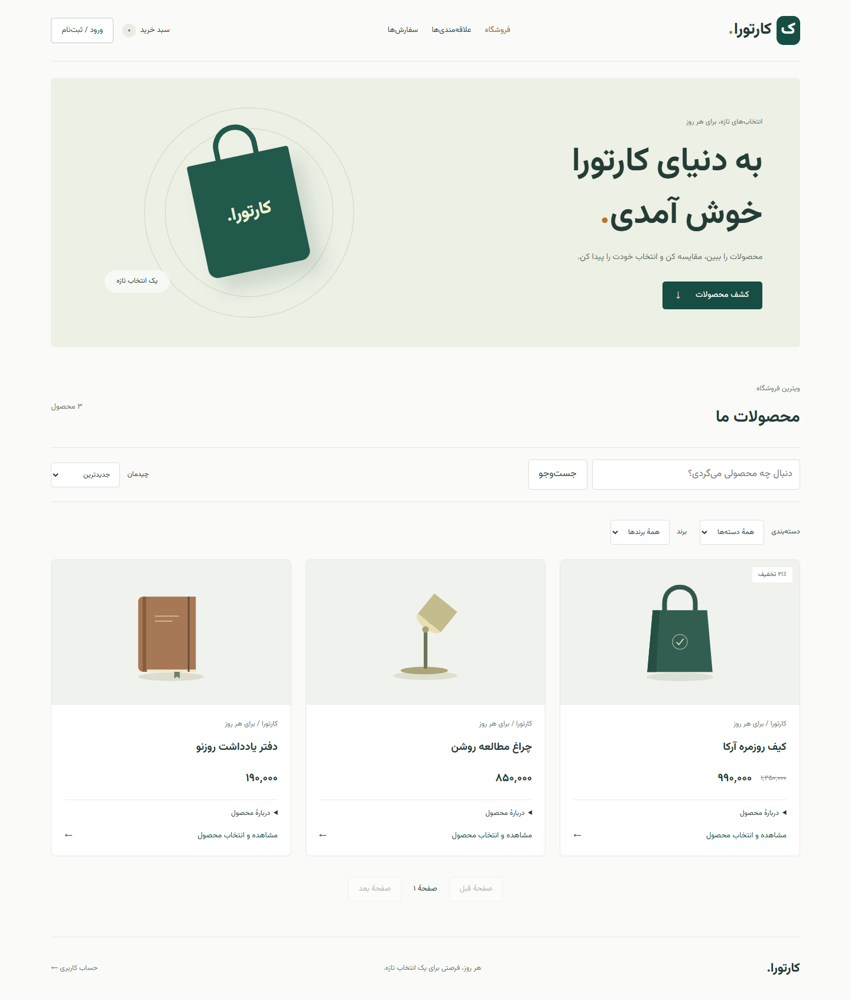

# کارتورا | Cartora

یک پروژهٔ فروشگاهی برای یادگیری عملی فول‌استک؛ با بک‌اند ماژولار **Django REST Framework** و فرانت مستقل **React**، رابط فارسی و راست‌چین.

[English README](README.md) · [راهنمای فرانت](frontend/README.md) · [آموزش React](frontend/docs/LEARNING.md) · [API](docs/API.md) · [توسعه و عیب‌یابی](docs/DEVELOPMENT.md)



پرداخت در این پروژه آزمایشی است و پول واقعی جابه‌جا نمی‌کند. تصاویر این راهنما از داده‌های نمونه ساخته شده‌اند؛ محصولات و فایل‌های شخصی داخل مخزن نیستند.

## چه چیزهایی پیاده شده؟

- جست‌وجو، فیلتر دسته و برند، مرتب‌سازی، صفحه‌بندی و جزئیات محصول
- گالری عکس، انتخاب تنوع و قیمت مربوط به آن
- ثبت‌نام، ورود و خروج JWT و تمدید نشست
- سبد خرید، مدیریت تعداد و نشانی‌های ذخیره‌شده
- ثبت سفارش با قیمت و مبلغ محاسبه‌شده در سرور، کوپن و روش ارسال
- پرداخت آزمایشی موفق و ناموفق، تلاش مجدد و سوابق تراکنش‌ها
- علاقه‌مندی‌ها، نظرات با تأیید مدیریت و اعلان‌های داخل سایت
- مدیریت داده‌ها در Django admin و مستندات Swagger
- تست خودکار، Docker Compose و workflow تست GitHub Actions

## پیش‌نیازها

Python 3.14 یا جدیدتر، Node.js 22.17 یا جدیدتر و PostgreSQL لازم‌اند. برای بک‌اند می‌توان از Docker استفاده کرد؛ در آن حالت نیازی به نصب محلی Python و PostgreSQL نیست. فرانت همچنان جداگانه با Node اجرا می‌شود.

## شروع در ویندوز

### ۱. دریافت پروژه و تنظیم محیط

```powershell
git clone https://github.com/iamirrd/cartora.git
cd cartora
Copy-Item .env.example .env
```

در `.env` مقدارهای `DJANGO_SECRET_KEY` و `POSTGRES_PASSWORD` را با مقدار شخصی جایگزین کن. برای اجرای محلی `DJANGO_DEBUG=True`، `ENABLE_MOCK_PAYMENTS=True` و `FIREBASE_ENABLED=False` بمانند. ساخت secret:

```powershell
python -c "import secrets; print(secrets.token_urlsafe(50))"
```

فایل `.env` وارد Git نمی‌شود. `DJANGO_DEBUG` بر متغیر قدیمی `DEBUG` اولویت دارد تا با تنظیمات ابزارهای دیگر در ویندوز تداخل نکند.

### ۲. اجرای بک‌اند؛ یکی از دو روش

**با Docker:** Docker Desktop را با Linux containers روشن کن و بزن:

```powershell
docker compose up --build
```

در ترمینال دیگر ادمین بساز:

```powershell
docker compose exec web python manage.py createsuperuser
```

**اجرای محلی با uv:** PostgreSQL را آماده و دیتابیس مطابق `.env` بساز. اگر فقط PostgreSQL را از Docker می‌خواهی، `docker compose up -d db` را اجرا کن. سپس:

```powershell
uv sync --frozen
uv run --frozen python manage.py migrate
uv run --frozen python manage.py createsuperuser
uv run --frozen python manage.py runserver
```

بک‌اند روی پورت ۸۰۰۰ است. راه‌اندازی با pip هم در [راهنمای توسعه](docs/DEVELOPMENT.md) آمده است.

### ۳. اجرای فرانت در ترمینال جدا

```powershell
cd frontend
npm.cmd ci
npm.cmd run dev
```

آدرس چاپ‌شده توسط Vite را باز کن؛ معمولاً `http://localhost:5173` است. `npm.cmd` در PowerShell جلوی مشکل اجرای `npm.ps1` را می‌گیرد. در Linux/macOS از `npm` استفاده کن.

| بخش | آدرس |
| --- | --- |
| فروشگاه React | http://localhost:5173 |
| پنل مدیریت | http://localhost:8000/admin/ |
| Swagger | http://localhost:8000/api/docs/ |
| Schema | http://localhost:8000/api/schema/ |

آدرس ریشهٔ پورت ۸۰۰۰ صفحه ندارد؛ 404 آن طبیعی است. فرانت روی پورت جدا اجرا می‌شود. ورود فروشگاه با JWT و ورود ادمین با session انجام می‌شود؛ این دو ورود مستقل‌اند.

## اولین محصول را چطور بسازم؟

با ادمین وارد پنل مدیریت شو و به ترتیب این‌ها را بساز:

۱. دسته‌بندی و برند، هر دو فعال.

۲. محصول فعال با نام، قیمت، دسته و برند بالا.

۳. عکس محصول؛ برای عکس جلد، `Is primary` را فعال کن.

۴. تنوع فعال با قیمت خودش، مثلاً «رنگ مشکی، ۱۲۸ گیگ».

۵. موجودی فعال برای همان تنوع با تعداد بیشتر از صفر.

محصول فقط وقتی نمایش داده می‌شود که **خود محصول، دسته و برند هر سه فعال باشند**. برای زدن تیک فعال‌بودن، روی نام رکورد در ادمین کلیک کن؛ داخل فرم `Is active` را تغییر بده و `Save` بزن. علامت سبز یا قرمز جدول فقط نمایش وضعیت است.

بعد صفحهٔ فروشگاه را رفرش کن. افزودن عکس در بخش Product images، محصول تازه نمی‌سازد؛ عکس را به محصول انتخاب‌شده وصل می‌کند. برای محصول جدید از Products استفاده کن.

## تست و build

از ریشهٔ پروژه:

```powershell
uv run --frozen python manage.py check
uv run --frozen python frontend/tests/backend_contract.py
```

از پوشهٔ `frontend`:

```powershell
npm.cmd test
npm.cmd run build
npm.cmd run test:e2e
```

تست مرورگر در ویندوز از Edge استفاده می‌کند؛ تنظیم Chromium برای سیستم‌های دیگر در [راهنمای فرانت](frontend/README.md#browser-tests) آمده است. تست قرارداد بک‌اند روی دیتابیس موقت در حافظه اجرا می‌شود و دیتابیس PostgreSQL شخصی را تغییر نمی‌دهد. تست مرورگر، پاسخ API را شبیه‌سازی می‌کند؛ تست کامل اتصال واقعی همچنان لازم است.

## چند مشکل رایج

| مشکل | بررسی |
| --- | --- |
| خطای 500 یا قطع ارتباط در فروشگاه | بک‌اند روی پورت ۸۰۰۰ روشن باشد؛ Network و ترمینال بک‌اند را ببین |
| ادمین بدون استایل | `DJANGO_DEBUG=True` و یک اجرای تازهٔ بک‌اند؛ سپس Ctrl+F5 |
| محصول دیده نمی‌شود | فعال‌بودن محصول، برند و دسته و فیلترهای URL را بررسی کن |
| افزودن به سبد خطا دارد | تنوع و موجودی فعال، تعداد کافی و ورود کاربر لازم است |
| تغییرات اعمال نمی‌شوند | مطمئن شو یک نسخهٔ سرور روی پورت اجراست؛ اجرای قدیمی `--noreload` را نباید هم‌زمان نگه داری |
| سفارش ثبت شد ولی پرداخت شکست خورد | از همان سفارش در «سفارش‌ها» دوباره پرداخت کن؛ سفارش تازه نساز |

## دامنهٔ فعلی پروژه

این نسخه برای یادگیری و نمایش مسیر خرید است. درگاه واقعی، بازیابی رمز و ویرایش پروفایل در React، ورود اجتماعی React و Push مرورگر آماده نیستند. providerهای OAuth و Firebase در بک‌اند به تنظیمات جداگانه نیاز دارند. برای انتشار عمومی هم تنظیمات production، سرو فایل‌ها، HTTPS، ایمیل و پشتیبان‌گیری لازم است؛ آپلود کد در GitHub به معنی آنلاین‌شدن فروشگاه نیست.

کد داخل `src` و اپ‌های جنگو است؛ `.env`، دیتابیس، محصولات، عکس‌های آپلودشده، `node_modules` و خروجی build/test منتشر نمی‌شوند. مجوز کلی پروژه هنوز انتخاب نشده است؛ مجوز فونت وزیرمتن در [OFL.txt](accounts/static/accounts/fonts/OFL.txt) قرار دارد.
