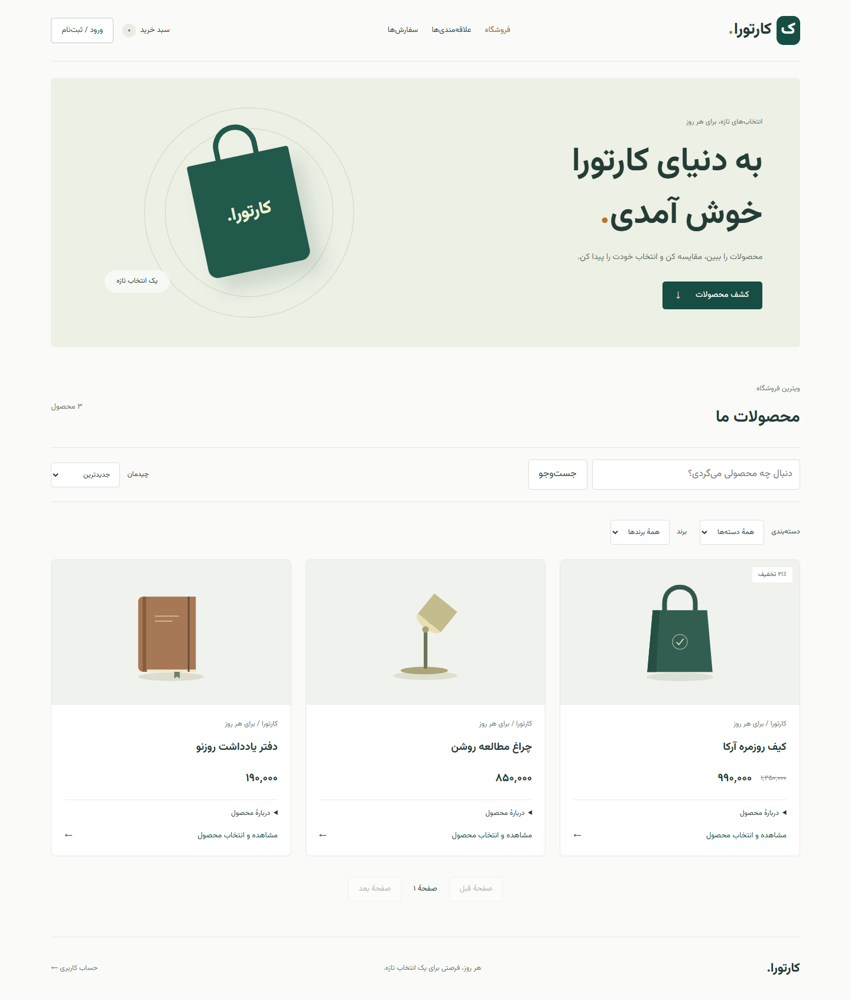
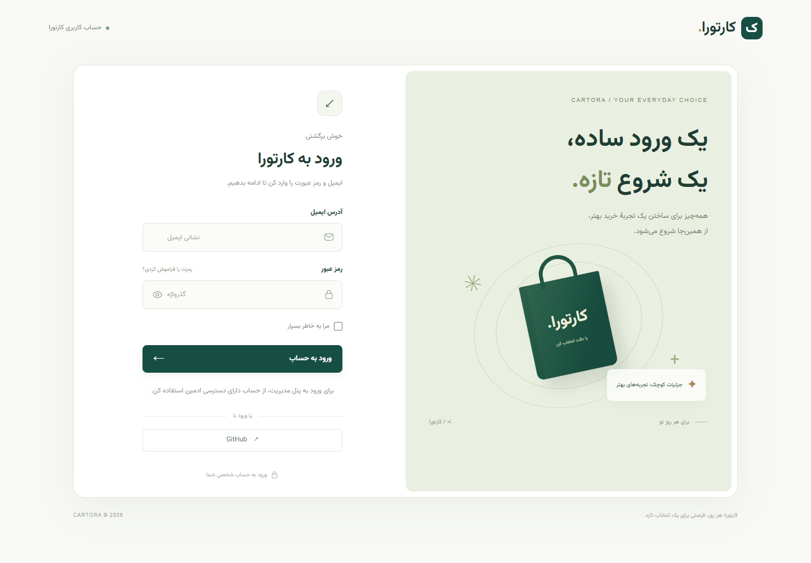
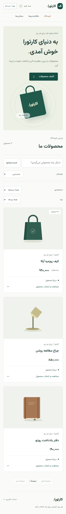

# Cartora

A modular e-commerce project with a **Django REST API** and a **React storefront**. Built as a practical full-stack learning project: browse products, choose a variant, manage a cart, place an order and complete a simulated payment.

[راهنمای فارسی](README.fa.md) · [Frontend](frontend/README.md) · [API](docs/API.md) · [Development & troubleshooting](docs/DEVELOPMENT.md) · [Learning React in Persian](frontend/docs/LEARNING.md)

> Payments are a development simulator. No real money is moved. The included setup is for local development, not a ready-made production deployment.

## Preview



<details>
<summary>Account login and mobile layout</summary>





</details>

The storefront screenshots use sample API responses; they do not include a user's database or uploaded product photos.

## Features

| Area | Included |
| --- | --- |
| Catalog | Search, category/brand filters, sorting, pagination, galleries and variants |
| Accounts | Email registration, JWT login, refresh and logout; separate session login for Django admin |
| Shopping | Server-backed cart, quantities, saved addresses and wishlists |
| Checkout | Order snapshots, shipping methods, coupons and server-calculated totals |
| Payments | Mock success/cancellation, retry, transaction history and idempotent verification |
| Community | Moderated reviews, owner editing/deletion and in-app notifications |
| Interface | Persian RTL storefront, responsive layouts, local Vazirmatn fonts and account templates |
| Tooling | OpenAPI/Swagger, Docker Compose, locked dependencies and automated checks |

## Stack

| Backend | Frontend | Development |
| --- | --- | --- |
| Python 3.14+, Django 6.1, DRF | React 19, React Router 7, JavaScript | PostgreSQL 16, Docker Compose |
| Simple JWT, django-allauth | Vite 6, CSS Grid/Flexbox | Node.js 22.17+, uv or pip |
| Pillow, optional Firebase | Local Vazirmatn fonts | Node test runner, Playwright, GitHub Actions |

## Quick start

### 1. Clone and configure

```bash
git clone https://github.com/iamirrd/cartora.git
cd cartora
cp .env.example .env
```

On PowerShell, use `Copy-Item .env.example .env` instead of `cp`.

Edit `.env`: replace `DJANGO_SECRET_KEY` and `POSTGRES_PASSWORD`. Keep `DJANGO_DEBUG=True`, `ENABLE_MOCK_PAYMENTS=True` and `FIREBASE_ENABLED=False` for local development. Generate a private secret with:

```bash
python -c "import secrets; print(secrets.token_urlsafe(50))"
```

### 2. Start the backend

**With Docker** — install Docker Desktop/Engine and use Linux containers:

```bash
docker compose up --build
```

In a second terminal:

```bash
docker compose exec web python manage.py createsuperuser
```

Compose starts PostgreSQL, runs migrations, collects static files and serves the API on port 8000. It does **not** start the React development server.

**Without Docker** — install Python 3.14+, PostgreSQL and uv. Create the database named in `.env` and set `POSTGRES_HOST=127.0.0.1`. Alternatively, run only PostgreSQL with `docker compose up -d db`.

```bash
uv sync --frozen
uv run --frozen python manage.py migrate
uv run --frozen python manage.py createsuperuser
uv run --frozen python manage.py runserver
```

The [development guide](docs/DEVELOPMENT.md) includes pip/Windows instructions.

### 3. Start the storefront

Install Node.js 22.17+ and open another terminal:

```bash
cd frontend
npm ci
npm run dev
```

On PowerShell, use `npm.cmd` if `npm.ps1` is blocked. Open the URL Vite prints, usually `http://localhost:5173`.

| Interface | Address |
| --- | --- |
| React storefront | http://localhost:5173 |
| Django admin | http://localhost:8000/admin/ |
| Swagger UI | http://localhost:8000/api/docs/ |
| OpenAPI schema | http://localhost:8000/api/schema/ |

The backend's `/` has no page; a 404 at `http://localhost:8000/` is expected. Frontend `/api/` and `/media/` requests are proxied to port 8000 by Vite.

### 4. Add your first product

Sign in to Django admin with the superuser and create:

1. An active category and brand.
2. An active product linked to that category and brand.
3. Optional product images; mark the intended cover image as primary.
4. An active product variant with its own price.
5. An active inventory record for that variant with a positive quantity.

The product, category **and** brand must all be active for public visibility. Buying requires a variant and stock. Refresh the storefront after adding catalog data in admin. A fresh clone has no products, user accounts or uploaded photos.

## Verify the project

From the repository root, after installing Python dependencies:

```bash
uv run --frozen python manage.py check
uv run --frozen python frontend/tests/backend_contract.py
```

From `frontend/`:

```bash
npm test
npm run build
npm run test:e2e
```

Browser tests use installed Edge on Windows. On other systems, install Playwright Chromium and select it as explained in the [frontend guide](frontend/README.md#browser-tests).

The API contract tests use actual Django views with a disposable SQLite database; they do not modify the application's PostgreSQL database. Browser tests use controlled API responses. These checks do not prove PostgreSQL locking behavior or replace a live end-to-end test. See [verification details](docs/DEVELOPMENT.md#verification).

GitHub Actions is configured to run backend checks, HTTP tests, the frontend build and browser flows on pushes to `main` and pull requests. Its first hosted result will be available after the workflow is pushed.

## Structure

```text
Cartora/
├── Config/                 # Django settings, routing and WSGI/ASGI
├── accounts/               # Registration, JWT and local authentication assets
├── products/               # Catalog, variants and inventory
├── cart/                   # User carts and quantities
├── order/                  # Checkout and immutable price snapshots
├── payment/                # Development-only payment simulator
├── address/ shipping/      # Delivery addresses and methods
├── coupon/                 # Discount rules
├── reviews/ wishlist/      # Reviews and saved variants
├── notification/ common/   # Notifications and shared backend primitives
├── templates/              # Django session-account templates
├── frontend/
│   ├── src/api/            # Shared HTTP client
│   ├── src/components/     # Shared UI
│   ├── src/features/       # Pages and logic grouped by capability
│   ├── src/hooks/          # Resource and mutation lifecycle
│   ├── tests/              # HTTP, browser and Django contract tests
│   └── docs/               # Persian React learning guide
├── docs/                   # API, development and preview images
└── .github/workflows/      # Automated checks; no deployment
```

## Configuration and limits

- `.env.example` contains placeholders; `.env`, credentials, databases, uploads, dependencies and generated artifacts are ignored by Git.
- `DJANGO_DEBUG` takes precedence over legacy `DEBUG`, avoiding conflicts with environment variables used by other tools.
- Prices are integer monetary amounts. The UI does not convert rial/toman; keep catalog, shipping and coupon amounts in one consistent unit.
- Storefront JWTs are kept in memory and tab-scoped `sessionStorage`; Django admin uses a separate session. API authorization is enforced by the server.
- Google/GitHub OAuth and Firebase push require separate configuration. They are not ready-to-use React login or push features.
- The React app has no profile editing or password-reset API flow. Allauth's server-rendered account routes are separate.
- Public deployment needs a dedicated setup for static/media serving, HTTPS, credentials, cookies, email, cache and backups. A live payment provider is not implemented.

See [configuration and deployment notes](docs/DEVELOPMENT.md) for details.

## Contributing and license

See [CONTRIBUTING.md](CONTRIBUTING.md) for setup, checks and pull requests. A project-wide license has not been selected. Third-party dependencies retain their own licenses; the bundled Vazirmatn font license is included in [OFL.txt](accounts/static/accounts/fonts/OFL.txt).
